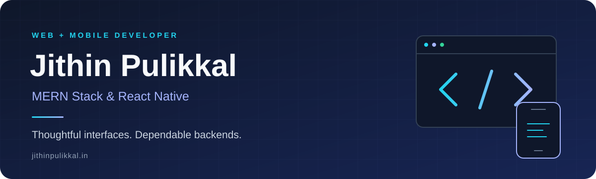



  

<strong>I build web and mobile experiences, from the API to the final interaction.</strong>

  
  
  

## Hey, I'm Jithin 👋

I'm a software developer focused on the **MERN stack** and **React Native**, with a particular interest in backend architecture and clean, usable interfaces. I enjoy connecting the pieces that make an app useful: data, APIs, and the screens people interact with.

- **On the web:** full-stack applications with MongoDB, Express, React, and Node.js.
- **On mobile:** app flows and shopping experiences with React Native and Expo.
- **Behind the scenes:** REST APIs, SQL Server, and backend architecture.
- **Through to launch:** deployment with Vercel, Netlify, and the Play Store.

## Selected work ✨

| Project | What I built |
| :--- | :--- |
| 🛒 **E-commerce platform** | Role-based pricing, wishlists, and advanced product filtering. |
| 📱 **Mobile shopping app** | A complete cart flow, wishlists, and API integrations. |
| 💼 **Job portal** | Job listings, WhatsApp integration, and Excel exports. |
| 💍 **Wedding website** | A Kerala-style invitation with an animated interface. |

**[Explore my portfolio →](https://jithinpulikkal.in)**

## Tools I work with 🛠️

  

| Area | Stack |
| :--- | :--- |
| **Frontend** | React · Tailwind CSS · Vite |
| **Mobile** | React Native · Expo |
| **Backend & data** | Node.js · Express · MongoDB · SQL Server |
| **APIs & delivery** | REST APIs · Axios · Vercel · Netlify · Play Store |

  
<strong>📊 A look at my GitHub activity</strong>

   
  

    
  

  [View my GitHub profile](https://github.com/jithinpulikkal) for contributions and repositories.

---

  <strong>Have an idea for a web or mobile app? Let's talk.</strong> 
  <a href="mailto:mail.jithinpulikkal@gmail.com">mail.jithinpulikkal@gmail.com</a>

Clean interfaces. Thoughtful architecture. Always building.

